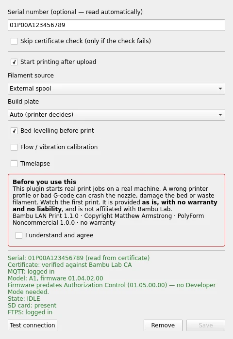
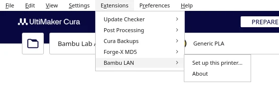
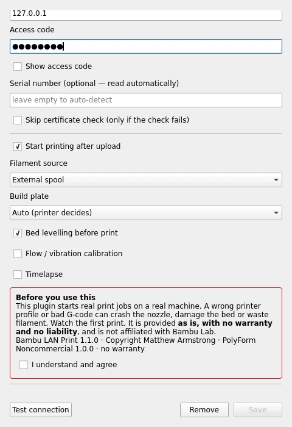
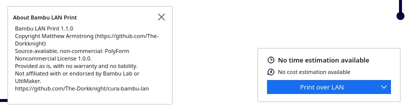
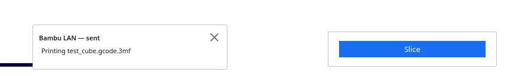

<p align="center"></p>

# Bambu LAN Print for Cura

> **Pre-release (1.1.0-beta.1).** It works inside Cura 5.13.0 against a simulated Bambu printer, but it has **not yet been tested on real Bambu hardware**. Watch your first print, and please [report how it goes](https://github.com/The-Dorkknight/cura-bambu-lan/issues).

**Source-available · Non-commercial.** Licensed under the [PolyForm Noncommercial License 1.0.0](LICENSE.md). Free for personal, hobby and other non-commercial use; commercial use needs my separate permission. Provided **as is, with no warranty and no liability**. This plugin starts jobs on a real machine: watch your first print.

Required Notice: Copyright Matthew Armstrong (https://github.com/The-Dorkknight)

A plugin for **UltiMaker Cura** that sends prints straight to a **Bambu Lab** printer on your local network. Slice in Cura, click **Print over LAN**, and the job uploads to the printer's SD card and starts. No Bambu cloud, no Bambu Connect, no Bambu Studio, and nothing extra to install: it uses Python's standard library and the community-documented LAN protocol.

> Not affiliated with or endorsed by Bambu Lab or UltiMaker.



## Contents

- [What you need](#what-you-need)
- [Install](#install)
- [Set up a printer](#set-up-a-printer)
- [Printing](#printing)
- [Your Cura printer profile](#your-cura-printer-profile)
- [Security and your network](#security-and-your-network)
- [Troubleshooting](#troubleshooting)
- [Known limitations](#known-limitations)
- [How it works](HOW_IT_WORKS.md) · [Changelog](CHANGELOG.md) · [Third-party notices](THIRD_PARTY.md) · [Security policy](SECURITY.md) · [Contributing](CONTRIBUTING.md)

## What you need

- **UltiMaker Cura 5.x** (tested on 5.13.0).
- A Bambu Lab printer on the same network as your computer, with an **SD card** inserted.
- The printer's **IP address** and **access code**, both on its network / LAN screen.
- Depending on the firmware:

| Firmware | What to turn on |
|---|---|
| **Older firmware**, before Bambu's *Authorization Control*: A1 / A1 mini before **01.05.00.00**, P1P / P1S before **01.08.02.00**, X1 series before **01.08.03.00** | Nothing else. The access code is enough. If it won't connect, turn on LAN-only mode. |
| **Newer firmware** (and H2D, P2 series always) | **LAN-only mode**, then **Developer Mode** (it appears in the same menu). Without it, the printer ignores print commands from other software. |

You don't need to know which you have: **Test connection** reads the model and firmware and tells you. If you're on older firmware and want to stay there, keep automatic updates off on the printer.

## Install

1. Download `BambuLAN-<version>.curapackage` from the [Releases page](https://github.com/The-Dorkknight/cura-bambu-lan/releases).
2. Open Cura and **drag the file onto the Cura window**.
3. Restart Cura when it asks.

| System | Manual install folder (if drag and drop doesn't work) |
|---|---|
| **Linux Mint / Ubuntu / Debian** (AppImage) | `~/.local/share/cura/<version>/plugins/` |
| **Linux** (Flatpak) | `~/.var/app/com.ultimaker.cura/data/cura/<version>/plugins/` |
| **macOS** | `~/Library/Application Support/cura/<version>/plugins/` |
| **Windows** | `%APPDATA%\cura\<version>\plugins\` |

Copy the whole `BambuLAN` folder there. **Help → Show Configuration Folder** opens the right place on any system.

## Set up a printer

1. In Cura, select (or add) the printer you use for your Bambu machine.
2. Open **Extensions → Bambu LAN → Set up this printer…**

   

3. The first time, read the notice in the red box and tick **I understand and agree**. **Save** stays greyed out until you do.

   
4. Click **Find printers on network** and pick yours, or type the **IP address** from the printer's screen.
5. Type the **access code** (8 characters, from the same screen). Tick **Show access code** to check it.
6. Leave **Serial number** empty; it's read automatically.
7. Click **Test connection**. A green report means everything works:

   ```
   Serial: 01P00A123456789 (read from certificate)
   Certificate: verified against Bambu Lab CA
   MQTT: logged in
   Model: A1, firmware 01.04.02.00
   Firmware predates Authorization Control (01.05.00.00) — no Developer Mode needed.
   State: IDLE
   SD card: present
   FTPS: logged in
   ```

8. Choose the print options:

| Option | Meaning |
|---|---|
| **Start printing after upload** | Untick to only copy the file to the SD card and start it from the printer's screen. |
| **Filament source** | *External spool*, or the AMS slot to print from. |
| **Build plate** | *Auto* lets the printer decide; otherwise pick the plate you have fitted. |
| **Bed levelling / Flow calibration / Timelapse** | Passed to the printer; levelling and flow only work if your start G-code supports them (see [profile](#your-cura-printer-profile)). |

9. Click **Save**.

Settings are stored per Cura printer, so several Bambu printers each get their own. **Remove** deletes the settings for the selected Cura printer.

## Printing

With the configured printer selected, slice as usual. The main button changes to **Print over LAN**; the arrow next to it still offers **Save to Disk**.



Click it. A progress message shows *Connecting → Uploading → Starting print*, then confirms when the printer reports it has started:



Before uploading, the plugin checks that the printer isn't already busy and has an SD card. If anything fails, the message says which step and why.

**Extensions → Bambu LAN → About** shows the version, copyright and licence.

## Your Cura printer profile

The printer runs exactly the G-code Cura produces, so the profile matters:

- **Machine size and origin:** set the bed size for your model (for example A1: 256 × 256 × 256 mm), origin **not** at centre, G-code flavour Marlin.
- **Start / End G-code:** copy the machine start and end G-code from Bambu Studio for your model (*Printer settings → Machine G-code*) and replace its `[placeholders]` with Cura's `{settings}`, for example `[nozzle_temperature_initial_layer]` → `{material_print_temperature_layer_0}` and `[bed_temperature_initial_layer_single]` → `{material_bed_temperature_layer_0}`.
- The **Bed levelling** and **Flow calibration** options only take effect if that start G-code contains Bambu's `M1002 judge_flag` checks, as Bambu Studio's does.

Start with a small test print and stay nearby.

## Security and your network

- The plugin makes connections **to** the printer only; it never listens for connections except while **Find printers on network** is running.
- It checks the printer's TLS certificate against Bambu Lab's certificate authorities and the printer's serial number, so your access code is only ever sent to a genuine Bambu printer. *Skip certificate check* exists for unusual firmware; leave it off if the test passes.
- Everything the printer sends back is parsed as JSON data and shown as plain text. Nothing from the printer is saved or run.
- The access code is saved in Cura's printer settings on your computer in plain text, as Bambu Studio does.

To keep a closed-firmware printer contained, put it on its own network or VLAN without internet access, and block incoming connections on your computer (Linux: `sudo ufw default deny incoming && sudo ufw enable`; macOS: turn on the firewall and Stealth Mode). The plugin still works: it only needs outgoing connections to ports 8883 and 990. See [HOW_IT_WORKS.md](HOW_IT_WORKS.md#security-design).

## Troubleshooting

| Message or problem | Fix |
|---|---|
| No **Print over LAN** button | Select the Cura printer you set up; the button only appears for configured printers. Check you accepted the notice and clicked **Save**. |
| *No answer from … on port 8883* | Wrong IP, printer off, or on a different network. Check the IP on the printer's screen. |
| *refused the connection on port 8883* | The printer isn't accepting LAN connections. Turn on LAN-only mode. |
| *Printer refused login: wrong access code* / *not authorised* | Re-type the access code. On newer firmware also turn on **Developer Mode**. |
| *certificate isn't signed by Bambu Lab's CA* | Unusual firmware or something between you and the printer. On a network you trust, tick **Skip certificate check**. |
| *Certificate check failed … Is the serial number right?* | Clear the **Serial number** box so it's read automatically. |
| *The printer is busy (RUNNING)* | Wait for the current job to finish or cancel it on the printer. |
| *No SD card in the printer* | Insert a card; LAN printing stores the job on it. |
| *Printer refused the job (…)* | The reason from the printer is shown. Send it in a bug report with the model and firmware from **Test connection**. |
| *Sent … the printer hasn't confirmed yet* | The file was sent but no confirmation arrived within 25 s. Check the printer's screen. |
| **Find printers** finds nothing | Your firewall may block the printer's broadcasts (UDP 2021), or the printer is on another subnet. Type the IP instead. |
| Print starts but prints wrongly | That's the Cura profile, not the transfer. See [Your Cura printer profile](#your-cura-printer-profile). |

Cura's log (**Help → Show Configuration Folder → cura.log**) has more detail; lines start with `Bambu LAN`.

## Known limitations

- **Not yet tested on a real printer.** The protocol code is tested against a simulated Bambu printer that enforces the real behaviour (TLS, login, FTPS session reuse, per-model file paths). The plugin was also run inside a real Cura 5.13.0 on Linux: menus, setup dialog, **Test connection** and **Print over LAN** all worked end to end against that simulated A1. Windows and macOS have not been tried. Please report how it goes on your machine.
- The screenshots come from a headless test machine without 3D graphics, so Cura's build-plate view is blank in them.
- Single-plate, single-colour jobs. Multi-colour AMS mapping (one filament per slot) isn't supported.
- No camera view, live progress or pause/cancel from Cura. Use the printer's screen.
- Needs an SD card in the printer.

## Photos

<!-- Add your own photos here once they exist:


-->

## Licence

[PolyForm Noncommercial License 1.0.0](LICENSE.md). This is **source-available**, not "open source" in the OSI sense; GitHub shows it as "Other". Third-party parts, including the bundled Bambu Lab CA certificates, keep their own terms: see [THIRD_PARTY.md](THIRD_PARTY.md).
